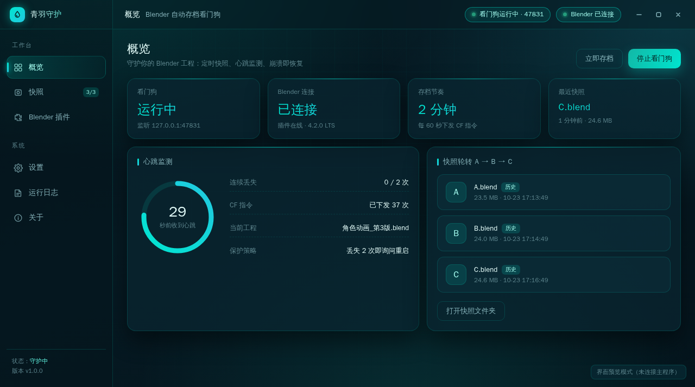

# AquaGuard

**Blender 崩溃救不回工程？这个跑在 Blender 外面的看门狗，让你最坏只丢 2 分钟。**

[](https://github.com/registerqd/AquaGuard-BlenderBackup/actions/workflows/build.yml)
[](https://github.com/registerqd/AquaGuard-BlenderBackup/releases/latest)
[](https://github.com/registerqd/AquaGuard-BlenderBackup/releases)
[](LICENSE)
[](#下载)
[](#)

<p align="center">
  
</p>

<p align="center">
  <a href="#下载">下载</a> ·
  <a href="#三分钟上手">三分钟上手</a> ·
  <a href="#它到底解决了什么">它解决什么</a> ·
  <a href="#130-新增">1.3.0 新增</a> ·
  <a href="#faq">FAQ</a> ·
  <a href="#english">English</a>
</p>

---

## 它到底解决了什么

Blender 崩溃的时候，**跑在 Blender 进程里的东西会一起死掉**——包括它自带的自动保存、包括所有插件。

雕刻到第 5 个小时，内存爆了，Blender 白屏无响应，你强杀进程，然后发现自动保存停在两小时前。这种情况每个月都会发生一次。

AquaGuard 是一个**跑在 Blender 外面的独立程序**。Blender 死了，它还活着，你最近的进度已经在硬盘上了。

| 场景 | Blender 自带自动保存 | 普通插件 | **AquaGuard** |
|---|---|---|---|
| 崩溃 / 闪退 | ⚠️ 一起死，临时文件常损坏 | ❌ 一起死 | ✅ **外部进程存活** |
| 卡死无响应 | ❌ 自己检测不了自己 | ❌ 线程被阻塞 | ✅ **心跳超时 + PING 探测** |
| 突然断电 | ⚠️ 多数时候文件已损坏 | ❌ 内存状态全丢 | ✅ **下次开机主动问你要不要恢复** |
| 磁盘占用 | 不定，可能堆积 | 不定 | ✅ **增量存储，只存变化块** |
| 历史版本 | 只有一份 | 要看实现 | ✅ **20 份时间轴，可单份取回** |

---

## 1.3.0 新增

### 🗜️ 增量快照——磁盘门槛下降一个数量级

以前每份快照都是完整复制 `.blend`，恒定占用 3 倍工程体积。**一个 40 GB 的雕刻工程要吃掉 120 GB，多数人到这里就放弃了。**

1.3.0 改成内容寻址分块存储（CAS）：

- 文件按 4 MB 切片，每片算 SHA-256，**同哈希只存一份**
- 快照本身只记录一张块哈希清单（几 KB）
- 雕刻场景通常只有局部网格在动，**实测增量体积约为全量的 2%~8%**

40 GB 的工程，第二份快照开始通常只增加几百 MB，而不是再来 40 GB。

### 🗂️ 同时守护多个工程

以前一次只能盯一个 `.blend`，多开的人第二个就失效。现在每个工程按文件路径生成稳定 ID，各自持有独立快照链与块仓库，**三个 Blender 同时开也互不干扰**。

### 🕐 快照浏览器

时间轴列出每份快照：时间、全量体积、本次新增体积、去重率。可以：

- **单份取回**：任意一份恢复成新的 `.blend`，不覆盖你当前工程
- **差异预览**：选中两份，对比对象级变化——哪些是新增、哪些被删掉了，确认无误再恢复
- **清理无引用块**：一键回收所有快照都不再引用的数据块

这一步把 AquaGuard 从「灾后救命」升级成「日常版本管理」。

### 📊 资源占用，直接写在界面上

常驻后台的软件，第一个问题永远是「吃多少内存」。顶栏常驻显示：

```
内存 82.4 MB    CPU 空闲 0%    常驻 2 小时 13 分
```

不用你去任务管理器猜。

### 💥 崩溃现场记录

环形缓冲持续记录最近 30 秒发生了什么：心跳、CF 指令、内存峰值、Blender 状态。异常退出时自动落盘一份现场快照，事后能回答「它崩的时候到底在干什么」。

### 🔍 恢复前 diff 预览

恢复不再是盲选。对比两份快照的对象清单，先看清楚再动手。

### 🌐 快照目录可指向 NAS / 网盘

备份目录支持任意路径——指向 NAS 挂载点或 OneDrive / 坚果云同步盘，快照自动上云，机器烧了也还在。

### 🖥️ 无头模式（渲染农场）

```bash
AquaGuard --headless
```

不开窗口，只跑守护。适合渲染农场、无 GUI 的 Linux 服务器。

---

## 下载

| 平台 | 文件 | 说明 |
|---|---|---|
| **Windows 10/11** | [`AquaGuard_Setup_x.y.z.exe`](https://github.com/registerqd/AquaGuard-BlenderBackup/releases/latest) | 安装版，推荐 |
| **Windows 便携** | [`AquaGuard_Setup_x.y.z.zip`](https://github.com/registerqd/AquaGuard-BlenderBackup/releases/latest) | 解压即用 |
| **Linux x64** | [`AquaGuard-x.y.z-linux-x86_64.AppImage`](https://github.com/registerqd/AquaGuard-BlenderBackup/releases/latest) | 双击即用 |
| **Linux x64** | [`AquaGuard-x.y.z-linux-x64.tar.gz`](https://github.com/registerqd/AquaGuard-BlenderBackup/releases/latest) | 解压后 `chmod +x AquaGuard` |
| **macOS (Apple Silicon)** | [`AquaGuard-x.y.z-mac-arm64.dmg`](https://github.com/registerqd/AquaGuard-BlenderBackup/releases/latest) | 首次打开需右键 → 打开 |

校验文件：`SHA256SUMS.txt`（同页下载）

**系统要求**：Blender 2.93 – 4.x · Windows 10/11 / Linux x64 / macOS (arm64) · 快照目录留出工程体积 1.2 倍以上的空间（增量存储后远低于以前）

---

## 三分钟上手

### 第 1 步：装主程序

- **Windows**：双击 `AquaGuard_Setup_x.y.z.exe`，一路下一步。建议勾选「开机自动启动」。
- **Linux**：解压后 `chmod +x AquaGuard && ./AquaGuard`
- **macOS**：解压 dmg，右键 App → 打开（第一次会被 Gatekeeper 拦，这是正常的）

装完托盘里会有一个青色小图标，它已经在守着了。

### 第 2 步：装 Blender 插件

1. 打开 AquaGuard → 左侧「**Blender 插件**」→ 点「**导出插件文件**」
2. 打开 Blender → `编辑 / Edit` → `偏好设置 / Preferences` → `插件 / Add-ons` → 右上角 `安装 / Install`
3. 选中刚导出的 `aqua_guard_addon.py`，然后在列表里勾选启用 **AquaGuard**

连上的瞬间，AquaGuard 右上角会从「Blender 未连接」变成绿色「**Blender 已连接**」。

### 第 3 步：正常干活

什么都不用做。想看状态就在 3D 视图按 `N`，侧边栏有 AquaGuard 面板：连接状态、心跳、手动存档、临时暂停。

**出事了会怎样？** Blender 卡死或崩溃时，桌面会弹一个置顶窗口问你「要不要恢复」。点「立即恢复」，它会拉起最新快照继续工作。

---

## 它有多可靠

> **最坏情况：丢最近 2 分钟，不是最近 5 小时。**

看门狗每 60 秒下发一次 `CF` 存档指令，插件每收到 2 次真正落盘一次（默认 2 分钟一份快照）。

告警前会先发 **PING 探测**：Blender 在跑重度渲染、烘焙、保存超大文件时主线程会卡顿几秒，直接判死会误杀正在渲染的工程。插件只要响应 PING，警报立刻解除。

**它从不主动杀进程。** 弹窗里点「立即恢复」才由你确认终止。

---

## 工作原理

```text
┌────────────────────────┐     TCP 127.0.0.1:47831      ┌────────────────────────┐
│   AquaGuard 看门狗      │ ─── CF 存档指令（60s） ────► │   Blender 插件          │
│   （独立桌面进程）       │ ◄─── HB 心跳（10s） ─────── │   （独立网络线程）       │
└────────────────────────┘                              └────────────────────────┘
            │                                                        │
            │  连续 2 次没心跳                                        │  每 2 次 CF：
            │  → 发 PING 探测                                        ▼
            │  → 仍无响应？                                     增量落盘（分块去重）
            ▼                                                  写入时间轴清单
     系统级置顶弹窗                                              （保留最近 20 份）
            │
            ├─► 点【立即恢复】：终止卡死的 Blender → 从块仓库重组最新快照 → 自动打开
            └─► 点【忽略】：抑制告警并重置计时
```

### 数据存在哪

| 内容 | 默认位置 |
|---|---|
| 增量块仓库 + 时间轴 | 我的文档 `AquaGuard备份/projects/<工程ID>/` |
| 恢复出来的文件 | 我的文档 `AquaGuard备份/` |
| 崩溃现场记录 | 我的文档 `AquaGuard备份/crashes/` |
| 程序配置 | Windows `%APPDATA%\AquaGuard\config.json`，Linux `~/.config/AquaGuard/` |
| 运行日志 | 同上目录 `logs/aquaguard.log` |

**卸载程序不会删你的快照**，它们独立存放。

---

## FAQ

**Q：会不会把硬盘塞满？**
不会。A/B/C 三槽轮转 + 增量分块，占用恒定在「工程体积 + 少量增量」。时间轴默认保留最近 20 份，更早的自动淘汰。

**Q：增量快照会不会因为丢块导致恢复失败？**
恢复前会校验块完整性，缺块会明确告诉你缺几个、而不是给你一个坏文件。界面上还有「清理无引用块」，只会删没有任何快照引用的块。

**Q：跑长渲染时会不会被误判成崩溃？**
不会。告警前先发 PING 探测，插件响应即解除。而且它从不主动杀进程，必须你点确认。

**Q：支持 Blender 4.x 吗？**
支持 2.93 – 4.x。插件是纯 Python，不需要编译。

**Q：多开 Blender 会互相覆盖吗？**
不会。每个工程按文件路径独立建链，三个工程三条时间轴。

**Q：快照能放 NAS 或网盘吗？**
可以，设置里把备份目录指过去就行。

**Q：Linux 下解压后打不开？**
多半是丢了执行权限，`chmod +x AquaGuard` 即可。Wayland 桌面可能需要 `--ozone-platform=wayland`。

**Q：macOS 提示「无法验证开发者」？**
右键 App → 打开，或 `xattr -dr com.apple.quarantine AquaGuard.app`。

---

## 从源码构建

```bash
git clone https://github.com/registerqd/AquaGuard-BlenderBackup.git
cd AquaGuard-BlenderBackup
npm install
npm start            # 开发运行
npm run dist:win     # 打包 Windows 安装包
```

Windows 下也可以直接双击 `一键打包.bat`，脚本会自动准备 Node.js 与依赖。

三平台安装包由 GitHub Actions 在打 tag 时自动构建发布，见 [`.github/workflows/build.yml`](.github/workflows/build.yml)。

---

## 参与

Issue 和 PR 都欢迎。报 bug 时请附上 `aquaguard.log` 的相关片段、Blender 版本号和操作系统。

如果你觉得它救过你一次，给个 ⭐ 就是最好的支持。

## License

[MIT](LICENSE)

---

<a name="english"></a>
# English

**A watchdog that runs outside Blender, so a crash costs you two minutes instead of five hours.**

[](https://github.com/registerqd/AquaGuard-BlenderBackup/actions/workflows/build.yml)

### Why

When Blender dies, everything inside its process dies with it, including its built-in autosave and every add-on. AquaGuard is a separate desktop process that keeps your work on disk no matter what happens to Blender.

### What's new in 1.3.0

- **Incremental snapshots** — content-addressed chunk storage. Files are split into 4 MB blocks and hashed; identical blocks are stored once. A 40 GB sculpt project used to cost 120 GB in snapshots, now the second snapshot onward adds a few hundred MB.
- **Multiple projects** — each `.blend` gets its own snapshot chain and block store. Run three Blender instances at once without conflicts.
- **Snapshot browser** — a timeline with size, incremental size and dedup ratio per snapshot. Restore any single snapshot, or diff two of them at object level before restoring.
- **Resource readout** — memory and CPU shown right in the title bar. No more guessing from the task manager.
- **Crash scene capture** — a 30 second ring buffer of events and memory, dumped to disk on abnormal exit.
- **NAS / cloud folders** — point the snapshot directory at a NAS mount or a synced folder.
- **Headless mode** — `AquaGuard --headless` for render farms and servers without a GUI.

### Install

1. Download the package for your platform from [Releases](https://github.com/registerqd/AquaGuard-BlenderBackup/releases/latest).
2. Open AquaGuard → **Blender Add-on** tab → **Export Add-on**.
3. In Blender: `Edit → Preferences → Add-ons → Install...`, pick `aqua_guard_addon.py`, enable **AquaGuard**.
4. Press `N` in the 3D Viewport for the AquaGuard sidebar panel.

Worst case you lose the last two minutes. It never kills your process without asking.

### Built for my dad

He sculpts figurines with tens of thousands of faces. Out-of-memory crashes used to wipe out hours of work. This started as a tool for him, and a real 5-hour session interrupted by a power cut is what proved the recovery path works.

MIT licensed. Issues and PRs welcome.
