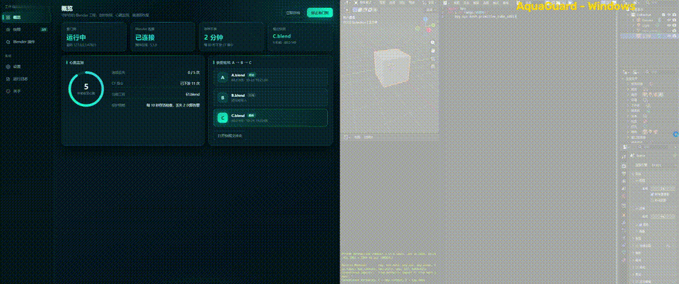
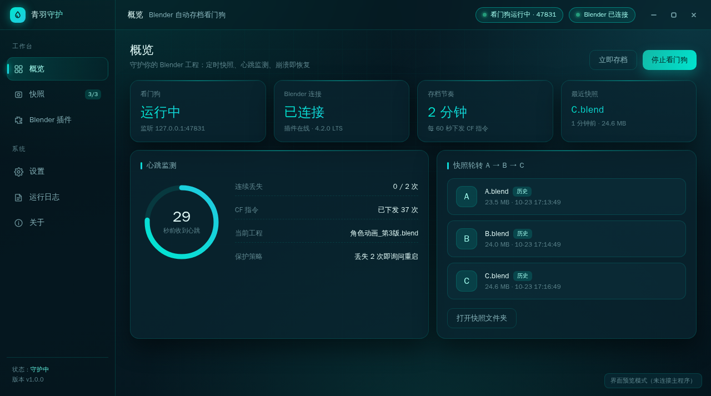

# AquaGuard — Blender Crash Recovery Watchdog

<p align="center">
  
</p>

<p align="center">
  <a href="https://github.com/registerqd/AquaGuard-BlenderBackup/releases/latest"></a>
  
  
  
  
</p>

<p align="center">
  <b>Never lose a Blender project to a crash, freeze, or sudden power outage again.</b><br>
  A lightweight watchdog running <b>outside</b> the Blender process — A/B/C rotating snapshots, TCP heartbeat, PING probe to avoid false alarms.
</p>

<p align="center">
  <a href="#english">English</a> ·
  <a href="#中文说明">简体中文</a> ·
  <a href="#faq">FAQ</a>
</p>

---

## Download

| Platform | Package | Notes |
|---|---|---|
| **Windows 10 / 11** | [`AquaGuard_Setup_1.1.0.exe`](https://github.com/registerqd/AquaGuard-BlenderBackup/releases/latest/download/AquaGuard_Setup_1.1.0.exe) | Installer, ~73 MB |
| **Linux x64** | [`AquaGuard-linux-x64.tar.gz`](https://github.com/registerqd/AquaGuard-BlenderBackup/releases/latest/download/AquaGuard-linux-x64.tar.gz) | Portable, ~102 MB |
| **macOS (Apple Silicon)** | [`AquaGuard-macos-arm64.tar.gz`](https://github.com/registerqd/AquaGuard-BlenderBackup/releases/latest/download/AquaGuard-macos-arm64.tar.gz) | Portable, ~93 MB |

All releases: [github.com/registerqd/AquaGuard-BlenderBackup/releases](https://github.com/registerqd/AquaGuard-BlenderBackup/releases)

<p align="center">
  
</p>

---

<a name="english"></a>
## English

### What is AquaGuard?

AquaGuard is a lightweight desktop watchdog that runs **completely outside of Blender**. It maintains rolling project snapshots and monitors a live heartbeat over a local TCP connection. When Blender freezes, crashes, or the machine suddenly loses power, your work is already safely written to disk.

### Built for My Dad

My dad sculpts figurines in Blender — complex models with tens of thousands of faces. Out-of-memory crashes and freezes used to happen regularly, meaning hours of sculpting were wiped out in an instant. So I built this watchdog for him.

Now, whenever Blender locks up, he simply terminates the hung process and restarts. The watchdog immediately detects the state, stages the latest snapshot, and reopens it. The fear of *"when was my last save?"* is completely gone.

### Proven by a Real 5-Hour Power Cut

During a 5-hour continuous modeling session, my computer suddenly lost power. Upon rebooting, AquaGuard launched with the system, detected the ungraceful shutdown flag, and prompted: *"Would you like to recover your project?"*

The entire scene was restored from the latest snapshot without a single byte lost. It asks exactly once, updates the state flag, and stays silent on future boots.

### How Reliable Is It?

> **Worst case: you lose the last 2 minutes — not the last 5 hours.**

The watchdog dispatches a snapshot command (`CF`) every 60 seconds. The add-on persists a snapshot every 2 commands (default: 2 minutes). Three snapshots (`A.blend`, `B.blend`, `C.blend`) rotate on disk, ensuring disk space remains bounded (~3× project size) while keeping 3 historical recovery points.

### Why Not Just Use Blender's Built-in Autosave or Add-ons?

When Blender crashes, **everything running inside the Blender process dies with it**.

| Feature | Blender AutoSave | Regular Add-on | AquaGuard Watchdog |
|---|---|---|---|
| **Process Isolation** | ❌ Dies with Blender | ❌ Dies with Blender | ✅ **External watchdog process** |
| **Sudden Power Outage** | ⚠️ Often corrupt or outdated | ❌ In-memory state lost | ✅ **Flagged on startup & 1-click recovery** |
| **Silent Freeze / Hang** | ❌ Cannot detect itself | ❌ Thread blocked | ✅ **Heartbeat timeout + PING probe** |
| **Recovery Workflow** | ⚠️ Hunt through `File -> Recover` | ⚠️ Manual file copying | ✅ **Native modal → Auto-open `61.blend...`** |
| **History Retention** | Overwritten or temp wiped | Variable | ✅ **Guaranteed A/B/C rotation** |

### How It Works

```text
┌────────────────────────┐     TCP 127.0.0.1:47831      ┌────────────────────────┐
│   AquaGuard Watchdog   │ ─── Save Command (60s) ────► │     Blender Add-on     │
│  (Desktop Background)  │ ◄─── Heartbeat (10s) ─────── │  (Dedicated NetThread) │
└────────────────────────┘                              └────────────────────────┘
            │                                                        │
            │  Missed ≥ 2 Heartbeats                                 │ Every 2 Commands:
            │  -> Dispatches PING Probe                              ▼
            │  -> Still silent?                                 Persist C.blend
            ▼                                                   Rotate C -> B -> A
     Native Alert Dialog                                        (Max 3 snapshots)
            │
            ├─► Click [Recover Now]:
            │     Terminate hung Blender -> Copy latest snapshot to 61.blend -> Auto Open
            └─► Click [Ignore]:
                  Suppresses alarm and resets timer
```

### Requirements

- **Blender** 2.93 – 4.x (add-on is pure Python, no build step)
- **Windows** 10/11, **Linux** x64, or **macOS** (Apple Silicon)
- ~3× your project size in free disk space for the snapshot slots

### Installation

#### 1. Watchdog App

**Windows** — run `AquaGuard_Setup_1.1.0.exe`, follow the wizard. Enabling **Launch at startup** is recommended.

**Linux** — unpack and run:

```bash
tar -xzf AquaGuard-linux-x64.tar.gz
cd AquaGuard-linux-x64
chmod +x AquaGuard
./AquaGuard
```

> If the archive was extracted through a file manager that strips the executable bit, `chmod +x AquaGuard` fixes it. On Wayland desktops you may need `--ozone-platform=wayland` for correct window placement.

**macOS** — unpack, then right-click → **Open** the first time to pass Gatekeeper:

```bash
tar -xzf AquaGuard-macos-arm64.tar.gz
cd AquaGuard-macos-arm64
xattr -dr com.apple.quarantine AquaGuard.app
open AquaGuard.app
```

#### 2. Blender Add-on

1. Open AquaGuard, go to the **Blender Add-on** tab, click **Export Add-on**.
2. In Blender: `Edit → Preferences → Add-ons → Install...`, pick `aqua_guard_addon.py`, enable **AquaGuard**.
3. Press `N` in the 3D Viewport to open the **AquaGuard** sidebar panel.

---

<a name="中文说明"></a>
## 中文说明

### 它解决什么问题

Blender 崩溃、卡死、断电时，**跑在 Blender 进程里的自动保存和插件会一起死掉**。AquaGuard 是一个跑在 Blender **外部**的独立看门狗进程：Blender 死了，它还活着，你最近的进度已经在硬盘上了。

### 核心亮点

- **独立进程守护**：Blender 就算崩成白屏、无响应或直接闪退，外部看门狗依然存活。
- **A / B / C 三槽轮转快照**：磁盘空间始终恒定（仅占 3 份工程体积），最老的一份自动淘汰，永远保留最新三档进度。
- **PING 探针防误杀**：Blender 在高负荷烘焙、重度渲染或存大文件时主线程易卡顿，看门狗在告警前主动发送 PING 探测，插件响应即解除，绝不误杀正在渲染的工程。
- **开机断电自愈**：断电关机前标记会话；下次开机自启弹窗询问是否打开断电前工程，确认后自动按 `61.blend`、`62.blend`… 递增另存，原工程零污染。
- **无缝打开**：无需配置 Blender 安装路径，直接调用系统关联默认程序启动恢复文件。

### 怎么使用

1. **运行主程序**：安装并启动 AquaGuard，托盘常驻。
2. **安装插件**：在主程序「Blender 插件」页点击导出，在 Blender「偏好设置 → 插件」里安装并启用。
3. **日常工作**：像平时一样建模、雕刻、渲染。3D 视图按 `N` 键可在侧边栏查看心跳与快照状态，也可随时手动点击「立即快照」。
4. **遇险恢复**：一旦遭遇崩溃或卡死，系统级原生弹窗自动置顶弹出，点击「立即恢复」即可一键拉起最新快照继续工作。

### 存储路径

| 文件类型 | 默认存放位置 |
|---|---|
| **轮转快照（A/B/C）** | 我的文档 `AquaGuard备份/` |
| **灾后恢复文件（61/62...）** | 我的文档 `AquaGuard备份/` |
| **程序配置文件** | `%APPDATA%\AquaGuard\config.json`（Linux: `~/.config/AquaGuard/`） |
| **运行日志** | `%APPDATA%\AquaGuard\logs\aquaguard.log` |

---

<a name="faq"></a>
## FAQ

**Q：会不会把硬盘塞满？**
不会。只有 A/B/C 三个槽位，写满后自动覆盖最老的一份，占用恒定在约 3 倍工程体积。

**Q：我在跑长渲染，它会不会误判成崩溃把 Blender 杀了？**
不会。看门狗在弹告警前会先发 PING 探针，插件只要响应就解除警报。而且它**从不主动杀进程**——弹窗里点「立即恢复」才由你确认终止。

**Q：和 Blender 自带的 Auto Save 有什么区别？**
自带自动保存在 Blender 进程内，Blender 崩了它就停了，且断电时临时文件经常损坏。AquaGuard 在进程外，并且断电前会写会话标记，下次开机主动问你要不要恢复。

**Q：支持 Blender 4.x 吗？**
支持 2.93 – 4.x。插件是纯 Python，不需要编译。

**Q：快照保存在哪？能改吗？**
默认在「我的文档/AquaGuard备份/」，可在主程序设置里改到其他盘。

**Q：卸载后我的备份文件会被删吗？**
不会，快照和恢复文件独立存放，卸载程序不碰它们。

---

## Build from Source

基于 Electron + Node.js 与 Blender Python API 开发，Windows 下支持一键全自动打包：

```bat
:: 方式 A：一键无依赖打包（自动下载免安装 Node.js 与依赖）
双击运行 "一键打包.bat"

:: 方式 B：常规开发运行
npm install
npm start

:: 方式 C：构建安装包
npm run dist:win
```

## Contributing

Issue 和 PR 都欢迎。报 bug 时请附上 `aquaguard.log` 里的相关片段和 Blender 版本号。

## License

[MIT](LICENSE)
